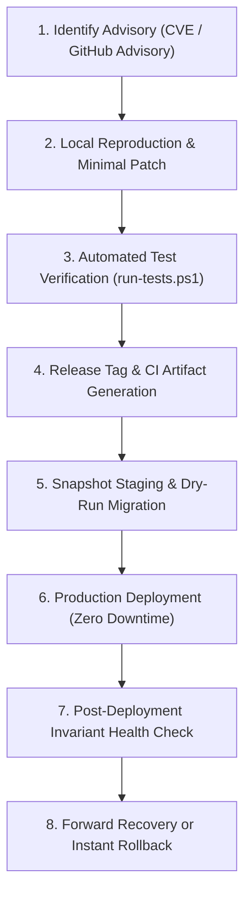

# Security, Updates & Patching Protocol

**Document:** `deployment/SECURITY_AND_PATCHING.md`  
**System:** ERP / CRM Dual-Stack Platform  

---

## 1. Guiding Principles for Zero-Downtime Updates

1. **Deterministic Migrations**: Database changes are strictly sequential, version-controlled, and idempotent. Migrations only add new nullable columns or tables; destructive drops are deferred until deprecation cycles complete.
2. **Configuration Preservation**: Production `.env` files, customer document uploads, and database records are never modified or overwritten during an application upgrade.
3. **Lockfile Enforcement**: All production builds must use committed lockfiles (`package-lock.json` and `composer.lock`).

---

## 2. Rapid Security Patch Workflow

When a security vulnerability is identified in an application dependency or framework component, follow this standardized 8-step protocol:



### Step 1: Identification & Impact Assessment
- Run `.\scripts\check-updates.ps1` to inspect affected packages.
- Check CVE severity rating (CVSS v3 score) and affected versions.

### Step 2: Minimal Patch Preparation
- Update only the affected package in `package.json` or `composer.json`.
- Avoid bundling unrelated feature changes with a critical security hotfix.

### Step 3: Local Test Execution
- Run `.\scripts\run-tests.ps1` to verify all acceptance suites pass:
  - Double-entry accounting balance verification.
  - Stock ledger movement tracking.
  - Leave approval balance deduction.
  - Deal pipeline stage advancement.

### Step 4: Staging Validation
- Deploy the patch artifact to a staging environment mirroring production.
- Execute database migrations via `php database/migrate.php` or `supabase db push`.

### Step 5: Production Deployment
1. Take an immediate database snapshot:
   ```bash
   mysqldump -u dreams_app -p dreams_erp > pre_patch_backup.sql
   ```
2. Pull latest release code.
3. Run migrations: `php database/migrate.php`.
4. Reload PHP-FPM / application workers: `sudo systemctl reload php8.3-fpm`.
5. Verify health endpoint: `curl -f https://erp.yourdomain.com/api/health`.

### Step 6: Safe Rollback Plan (If Needed)
If a critical defect emerges post-deployment:
1. Revert to the prior Git tag / release commit.
2. If migrations did not introduce breaking table changes, simply restart application workers.
3. If database restoration is required:
   ```bash
   mysql -u dreams_app -p dreams_erp < pre_patch_backup.sql
   ```
