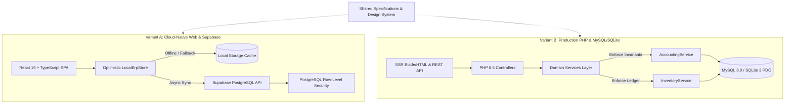
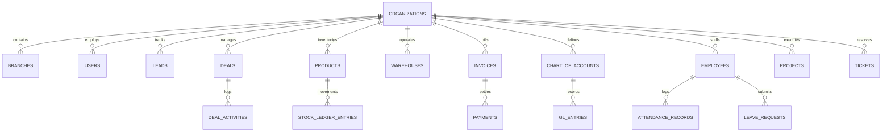

# ERP Platform — Technical Architecture Specification

## 1. System Overview & Dual-Stack Architecture
The **ERP** platform is engineered as an enterprise-grade business suite running across two independent, fully functional technology variants:

Both variants operate with complete independence:
1. **Variant A** requires only a web server or static host (e.g., GitHub Pages) and a Supabase project.
2. **Variant B** requires standard PHP 8.2+ and MySQL 8.0+ (or SQLite 3 for zero-admin operation), with no dependency on Supabase or Node.js.

---

## 2. Multi-Tenant Organization Isolation
Every business record in the ERP data dictionary includes an `organization_id` tenant identifier. Cross-tenant leakage is strictly prevented:
- **Variant A (Supabase)**: Enforced via PostgreSQL Row-Level Security (`ALTER TABLE <table> ENABLE ROW LEVEL SECURITY;`). Tenant isolation policies ensure users only query or mutate rows matching their active tenant membership.
- **Variant B (PHP)**: Enforced via `TenantContext` and parameter binding in all repository queries (`WHERE organization_id = :orgId`).

---

## 3. Relational Data Model & Core Entities

### Core Entity Specifications:
1. **`organizations`**: Master tenant root entity (`id`, `name`, `subdomain`, `currency`, `created_at`).
2. **`leads`**: CRM prospect tracking (`id`, `name`, `company`, `email`, `phone`, `source`, `status`, `assigned_to`, `value`).
3. **`deals`**: Sales opportunities (`id`, `name`, `stage`, `probability`, `value`, `due_date`, `follow_up_date`, `tags`, `priority`, `source`, `owner_id`).
4. **`deal_activities`**: Multi-channel activity records (`id`, `deal_id`, `type`, `title`, `description`, `created_at`, `priority`, `reminder`, `assigned_to`). Types: `activity`, `note`, `call`, `file`, `email`.
5. **`products`**: Catalog items (`id`, `code`, `name`, `sku`, `category`, `brand`, `unit`, `quantity`, `selling_price`, `purchase_price`, `reorder_level`).
6. **`stock_ledger_entries`**: Immutable physical movements (`id`, `product_id`, `warehouse_id`, `voucher_type`, `qty_change`, `balance_after`, `created_at`).
7. **`invoices`**: Billing documents (`id`, `invoice_number`, `customer_name`, `amount`, `status`, `due_date`).
8. **`chart_of_accounts`** & **`gl_entries`**: Double-entry general ledger records (`id`, `account_code`, `debit`, `credit`, `voucher_no`, `posting_date`).
9. **`employees`**: Workforce profiles (`id`, `first_name`, `last_name`, `email`, `department`, `designation`, `leave_balance`, `salary`).
10. **`projects`**: Project tracking (`id`, `code`, `name`, `description`, `progress`, `deadline`, `status`).
11. **`tickets`**: Customer support tickets (`id`, `code`, `subject`, `customer_name`, `priority`, `status`, `created_at`).

---

## 4. Financial & Inventory Invariants

### 4.1 Double-Entry Balance
For every journal entry or transaction posting $T$:
$$\sum_{i \in T} \text{Debit}_i - \sum_{i \in T} \text{Credit}_i = 0$$
Any posting where the debit/credit variance $|\Delta| > 0.001$ is rejected atomically with an invariant violation exception.

### 4.2 Immutable Stock Ledger
Stock quantities are never directly updated via destructive `UPDATE products SET quantity = X`. Instead:
1. Every stock change writes a cryptographically verifiable or audit-logged row to `stock_ledger_entries`.
2. The current physical quantity is derived as:
   $$Q_{\text{current}} = Q_0 + \sum \Delta Q_i$$
3. Denormalized cache fields on `products.quantity` are updated within the same database transaction.

---

## 5. Security & DevSecOps Controls
- **Zero Committed Secrets**: `.env.example` templates contain no production API keys, service role credentials, or database passwords.
- **Client Security**: The public frontend uses only the Supabase `anon` public key; administrative mutations require authenticated tokens or server-side service keys.
- **SQL Injection Prevention**: All PHP queries use PDO prepared statements with parameterized inputs.
- **Cross-Site Scripting (XSS)**: React 19 JSX auto-escapes rendered text; PHP output utilizes `htmlspecialchars($str, ENT_QUOTES, 'UTF-8')`.
- **Audit Trails**: Critical mutations (deal won/lost, invoice payment, leave approval, stock adjustment) append records to `audit_logs`.
