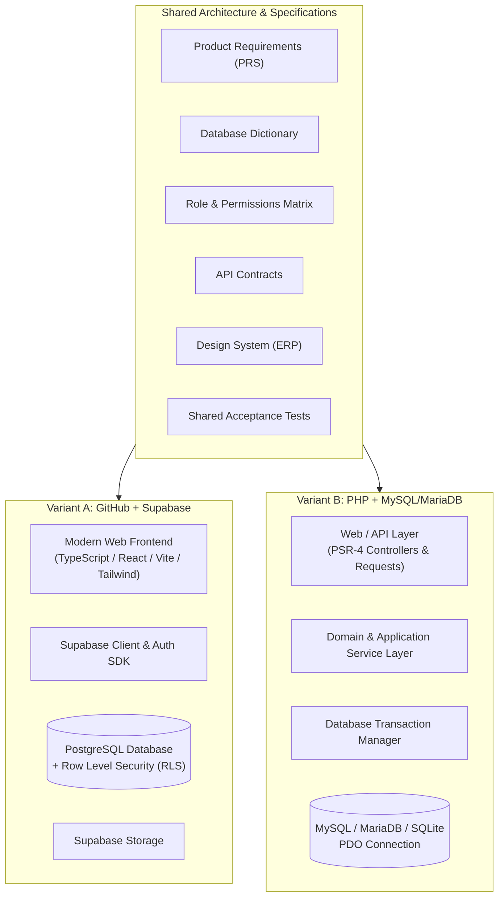

# Dual-Stack System Architecture Specification

**Document:** `shared-specifications/ARCHITECTURE.md`  
**System:** ERP / CRM Dual-Stack Platform  
**Version:** 1.0.0  

---

## 1. High-Level Architectural Vision

The platform delivers enterprise ERP/CRM capabilities with two independently runnable implementations adhering to a single business and data specification:



---

## 2. Variant A: Modern Web Frontend + Supabase

### 2.1. Technology Choices & Justification
- **Frontend Framework**: **React 18/19 + TypeScript + Vite**:
  - Unmatched developer velocity, zero bloat, instant HMR on Windows.
  - Type-safe integration with Supabase generated database types (`Database['public']['Tables']`).
- **Styling**: **Tailwind CSS + Tailwind Animate**:
  - Faithful pixel-level reproduction of the supplied "ERP" visual references (`02_CRM_Dashboard.jpg` through `09_Projects.jpg`).
- **Icons**: **Lucide React**:
  - Matches the clean, minimal aesthetic of modern enterprise ERPs.
- **Backend & Database**: **Supabase**:
  - Managed PostgreSQL instance.
  - Supabase Auth: Built-in secure JWT handling, email/password authentication, and session refreshment.
  - Row Level Security (RLS): Mandatory policies on every table restricting reads, inserts, updates, and deletes to the user's authorized `organization_id` and role permissions.
  - Zero Service-Role Exposure: Browser client uses only the public anonymous key. All multi-tenant barriers are enforced at the PostgreSQL engine level via `auth.uid()` and security definer helper functions.

### 2.2. Directory Structure (`variant-a-supabase/`)
```
variant-a-supabase/
├── .github/
│   └── workflows/
│       └── ci.yml               # Lint, Type-Check, Build, Test CI
├── supabase/
│   ├── migrations/              # Version-controlled sequential SQL migrations
│   │   ├── 20261027000001_initial_schema.sql
│   │   ├── 20261027000002_rls_policies.sql
│   │   └── 20261027000003_seed_data.sql
│   └── config.toml
├── src/
│   ├── assets/                  # Brand assets & reference icons
│   ├── components/              # Reusable UI components (Cards, Tables, Badges, Modals)
│   │   ├── common/              # Buttons, inputs, search, status pills
│   │   ├── layout/              # Sidebar, TopNav, Header, Footer
│   │   ├── crm/                 # Pipeline chevrons, deal stages, activity timeline
│   │   ├── hrm/                 # Attendance cards, leave balance widget, employee directory
│   │   ├── finance/             # CoA tree, ledger tables, invoice templates
│   │   └── inventory/           # Stock badges, warehouse utilization gauges
│   ├── context/                 # AuthContext, TenantContext, ThemeContext
│   ├── hooks/                   # Custom data-fetching hooks
│   ├── lib/                     # Supabase client singleton, API helpers, formatters
│   ├── pages/                   # Route views mapped directly to ERP dashboards
│   │   ├── DashboardPage.tsx    # CRM / Executive dashboard
│   │   ├── HrmDashboardPage.tsx
│   │   ├── InventoryPage.tsx
│   │   ├── SalesOrdersPage.tsx
│   │   ├── DealsPage.tsx
│   │   └── AccountingPage.tsx
│   ├── types/                   # Database interfaces, DTOs, Enums
│   ├── App.tsx
│   └── main.tsx
├── package.json
├── tsconfig.json
├── vite.config.ts
└── .env.example
```

---

## 3. Variant B: PHP + MySQL/MariaDB Architecture

### 3.1. Technology Choices & Justification
- **Runtime**: **PHP 8.2+**:
  - Modern PHP with strict types (`declare(strict_types=1);`), constructor property promotion, enums, readonly classes, and match expressions.
- **Database Engine**: **MySQL 8.0+ / MariaDB 10.11+ / SQLite 3 (Development)**:
  - Database-agnostic PDO persistence layer with explicit transaction management (`beginTransaction()`, `commit()`, `rollBack()`).
- **Architectural Pattern**: **Modular Service Monolith**:
  - Layered separation following PSR-4 and clean enterprise patterns without framework bloat.
  - Zero heavy third-party lock-in: Can run standalone on Windows built-in PHP server or production Apache/Nginx.

### 3.2. Layered Structure
```
variant-b-php-mysql/
├── config/                      # Application, database, and auth configuration
│   ├── app.php
│   └── database.php
├── database/
│   ├── migrations/              # Deterministic versioned migrations
│   │   ├── 001_create_foundation_tables.php
│   │   ├── 002_create_crm_tables.php
│   │   ├── 003_create_hrm_tables.php
│   │   ├── 004_create_finance_tables.php
│   │   └── 005_create_inventory_tables.php
│   └── seeders/                 # Realistic seed data
│       └── DatabaseSeeder.php
├── public/                      # Public document root
│   ├── index.php                # Front controller
│   ├── assets/                  # Compiled styles, icons, scripts
│   └── .htaccess
├── src/
│   ├── Core/                    # Router, Request, Response, Database, Container
│   ├── Middleware/              # TenantScoping, AuthMiddleware, CSRF, RateLimiter
│   ├── Models/                  # Entity classes (User, Lead, Deal, Employee, Invoice, Stock)
│   ├── Repositories/            # Safe parameterized database access
│   ├── Services/                # Core business rules & transactional workflows
│   │   ├── AccountingService.php
│   │   ├── InventoryService.php
│   │   ├── PayrollService.php
│   │   └── SalesPipelineService.php
│   └── Controllers/             # REST API & Web Controllers
│       ├── AuthController.php
│       ├── CrmController.php
│       ├── HrmController.php
│       ├── FinanceController.php
│       └── InventoryController.php
├── tests/                       # Automated unit and integration tests
├── .env.example
├── composer.json
└── README.md
```

---

## 4. Multi-Tenant Isolation & Security Strategy

### 4.1. Row Level Security in Variant A (PostgreSQL)
Every table containing organization-scoped data contains an `organization_id UUID NOT NULL REFERENCES organizations(id)`.
The RLS policy enforces tenant boundaries using:
```sql
CREATE POLICY tenant_isolation_policy ON deals
FOR ALL
USING (
  organization_id IN (
    SELECT o.id FROM organization_memberships om
    JOIN organizations o ON o.id = om.organization_id
    WHERE om.user_id = auth.uid()
  )
);
```

### 4.2. Middleware & Query Scoping in Variant B (PHP)
Every incoming authenticated request resolves the active `organization_id` from the authenticated session / JWT claims.
All repository queries automatically inject the active tenant boundary:
```php
$stmt = $pdo->prepare("SELECT * FROM deals WHERE organization_id = :org_id AND id = :id");
$stmt->execute(['org_id' => $currentOrgId, 'id' => $dealId]);
```

---

## 5. Transactional Invariants

1. **Accounting Invariant**:
   No financial posting may commit unless:
   $$\sum \text{Debit} = \sum \text{Credit}$$
   Any imbalance raises an `UnbalancedTransactionException` and triggers an immediate database rollback.

2. **Inventory Invariant**:
   Stock balances cannot be decremented below zero if `allow_negative_stock` is false. Every stock modification must append an immutable entry to `stock_ledger_entries`.

3. **Leave Balance Invariant**:
   Approving a leave request must atomically decrement the employee's `leave_allocations.remaining_days` within a database transaction.
